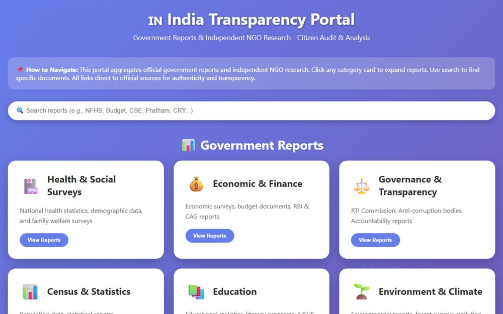

# India Transparency Portal

One page that collects Indian government and NGO reports into a single browsable index.

**[Open the live site](https://ajeet-iitk.github.io/india-reports/)**

## What it does

A curated directory of Indian public reports - government publications, audit findings, welfare and policy documents - grouped so they can be found in one place instead of across a dozen ministry sites.

## Features

- Grouped link index with short descriptions
- Fully static: no backend, no tracking, no accounts
- Adding a report is a single HTML edit

## Run locally

Open `index.html`, or use the hosted copy:

<https://ajeet-iitk.github.io/india-reports/>

## Files

| File | Purpose |
| --- | --- |
| `index.html` | Landing page |
| `indian_govt_reports.html` | The directory itself |

---

Part of [my collection of small projects](https://github.com/Ajeet-iitk).
